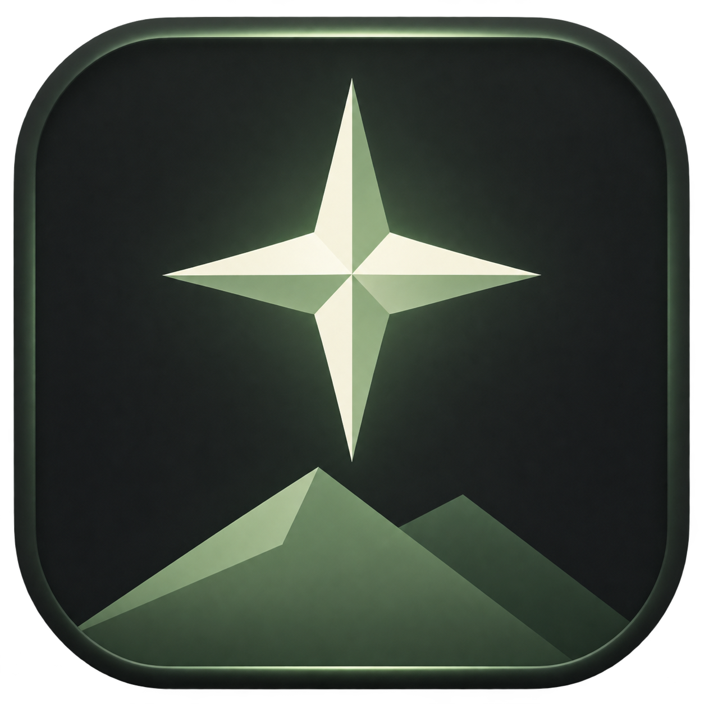

# Starlight Launcher



**[Скачать установщик Windows x64](https://github.com/rostfrolov2021-jpg/Starlight-Launcher/releases/latest)** · [История выпусков](RELEASES.md) · [Как публиковать обновления](docs/GITHUB_RELEASES.md)

Установленный лаунчер получает подписанные обновления из GitHub Releases. С версии 1.3 локальный сервис для этого не нужен. Исходники опубликованы отдельно от пользовательских данных и закрытого ключа подписи.

Десктопный Minecraft Java launcher: C# / .NET 8 / Avalonia, с отдельным ASP.NET Core сервером для друзей, чата, NAT rendezvous и резервного туннеля.

## Быстрый старт Windows

* Готовый лаунчер: `artifacts/publish/win-x64/Starlight.exe` или `run.bat`.
* Установщик: `Starlight-Setup-1.3.0-win-x64.exe` на странице последнего выпуска; локально — `artifacts/installer` после сборки Inno Setup.
* Приложение публикуется self-contained: системный .NET устанавливать не нужно.
* Создайте Offline-профиль на странице «Аккаунты», затем сборку на странице «Мои сборки». Выберите версию, загрузчик и память, нажмите «Играть».
* Первый запуск скачивает Minecraft и Java. Offline-профиль не проходит проверку лицензии на online-mode серверах.

## Сборка

Требуется .NET 8 SDK. В этой рабочей копии SDK установлен в `.tools/dotnet`; он не меняет системный SDK. Все версии NuGet зафиксированы в проектах. `System.Text.Json` включён в .NET 8.

```powershell
.\build.bat
.\build.bat -Runtime win-x64 -Installer
# Доступные цели: win-x64, win-arm64, linux-x64, linux-arm64, osx-x64, osx-arm64
.\build.bat -Runtime linux-x64
```

```sh
sh build.sh linux-x64
sh build.sh osx-arm64
```

Inno Setup 6 компилирует `installer.iss`. В этой рабочей копии его можно вызвать как `.tools/inno/ISCC.exe installer.iss`. Удаление по умолчанию сохраняет игровые данные. Полная очистка требует отдельного выбора пользователя. Тихое удаление всегда сохраняет данные.

Linux требует системные библиотеки оконной системы и шрифтов, используемые Avalonia/Skia (X11, fontconfig). Native SDL поставляется через `Ultz.Native.SDL`; доступ к микрофону управляется ОС. macOS-дистрибутив не подписан и не notarized. Сценарии сборки предусмотрены для всех перечисленных RID; локально проверялась Windows x64.

## Архитектура

* `Starlight.Domain`: модели аккаунтов, сборок, модов, серверов и контракт адаптера маркетплейса.
* `Starlight.Infrastructure`: хранение, OAuth, загрузки, CmlLib, Java, моды, серверные процессы, SignalR, прямой и резервный туннели, Opus/SDL.
* `Starlight.Desktop`: Avalonia XAML, MVVM, команды, обработка ошибок, прогресс и отмена, ограниченный буфер консоли.
* `Starlight.Server`: регистрация, хеширование паролей PBKDF2, друзья, группы, присутствие, проверка доступа к комнатам, UDP rendezvous и WebSocket relay.
* `Starlight.Tests`: исполняемый набор функциональных проверок без отдельного тестового фреймворка. Любая ошибка возвращает ненулевой exit code.

Данные Windows: `%APPDATA%/.starlight`. Linux/macOS: `~/.starlight`. Для тестов можно задать `STARLIGHT_HOME`.

```text
.starlight/
  config/                  настройки, Offline-профили, accounts.enc
  runtimes/                проверенные изолированные Java runtimes
  instances/<uuid>/
    instance.json
    installed-mods.json
    .minecraft/{mods,config,saves,resourcepacks,...}
  local_servers/<uuid>/    server.json, server.jar, eula.txt, world/
  cache/                   метаданные, архивы, удалённые/заменённые моды
  logs/launcher.log         ротация по размеру, до пяти файлов
```

Имена сборок — отображаемые подписи; пути используют UUID, поэтому русские названия и одинаковые имена не создают коллизий. Приложение не меняет обычную `.minecraft`.

## Аккаунты и секреты

Offline UUID соответствует алгоритму Java `OfflinePlayer:<name>`. Ник ограничен 3–16 латинскими буквами, цифрами и `_`.

Microsoft: вход по одноразовому коду на официальной странице (device-code flow), с отменой и ожиданием подтверждения; затем Xbox Live → XSTS → Minecraft Services → профиль/URL официального скина. Перед запуском просроченный Minecraft access token обновляется через Microsoft refresh token. Для работы нужен собственный Microsoft application client ID с поддержкой личных аккаунтов, включённым Allow public client flows, а также разрешённый доступ приложения к Xbox/Minecraft APIs. Подставного чужого client ID нет.

Токены не записываются в JSON-настройки. «Сохранить аккаунты» шифрует их AES-256-GCM с ключом PBKDF2-SHA256 (600 000 итераций, случайная соль). Пароль хранилища остаётся только в памяти; после перезапуска требуется разблокировка. Без сохранения Microsoft-сессия существует только до закрытия приложения. Пароль хранилища восстановить нельзя. При прямом подключении CurseForge developer API key хранится в пользовательском `settings.json`, поэтому этот файл не следует публиковать. При привязке сервиса ключ остаётся на сервере и не передаётся клиентам.

## Версии, Java и моды

Официальный Mojang manifest определяет требуемую Java: в частности 1.17 использует 16, 1.18–1.20.4 — 17, 1.20.5+ соответствующего поколения — 21. Новые версии также берут `javaVersion.majorVersion` из метаданных, а не из приближённого сравнения строк. Adoptium JRE загружается с проверкой SHA-256; если конкретная комбинация версии/архитектуры отсутствует у поставщика, показывается ошибка.

Vanilla устанавливается CmlLib.Core 4.1.0 с включённой проверкой размера и SHA-1 библиотек. Fabric использует официальный profile API; Forge — официальный CmlLib installer; NeoForge — официальный Java installer и Maven metadata. Можно задать точную версию загрузчика при создании сборки. Автовыбор NeoForge рассчитан на ветки Minecraft 1.20.2+ с форматом `1.x.y`; для новой схемы номеров Minecraft укажите точную версию NeoForge. Загрузка модов фильтруется по Minecraft и загрузчику.

Modrinth работает без ключа. CurseForge требует developer API key и уважает запрет автора на сторонние загрузки. Обязательные зависимости разрешаются рекурсивно с обнаружением циклов и конфликтов закреплённых версий. Все файлы сначала проходят загрузку/проверку в cache, затем заменяются с откатом при ошибке файловой операции. Старые версии сохраняются в `cache/mod-transactions`. Моды, убранные пользователем, сохраняются в `cache/deleted-mods`. Папка наблюдается через FileSystemWatcher; `.jar.disabled` сохраняет отключённое состояние.

## Локальные серверы и соединение с другом

Vanilla, Fabric, Paper, Spigot, Forge, Nukkit и гибриды Arclight/Youer: установка ядра, конфигурация, Java и управление процессом. Справа доступны вкладки «Консоль», «Настройки», «Подключение»: команды, OP/deop, сохранение мира, online-mode, доступ из сети, whitelist и порт. Настройки сохраняются у остановленного сервера с резервной копией server.properties. Nukkit предназначен для Bedrock и использует UDP; остальные ядра — для Java и TCP. Spigot собирается официальным BuildTools с отдельным JDK; первая установка заметно дольше скачивания готового JAR. Перед созданием требуется принять Minecraft EULA. Paper API требует контактный URL в настройках.

Сервер по умолчанию слушает только `127.0.0.1` и сохраняет `online-mode=true`. «Открыть для друзей» публикует комнату только после запуска процесса. Друг выбирает нужную совместимую сборку и нажимает «Присоединиться»: лаунчер открывает локальный TCP-порт и передаёт его Minecraft через параметры запуска.

Прямой маршрут использует LiteNetLib NAT introduction и ReliableOrdered UDP, ограниченное окно передачи и AES-GCM. Если прямое соединение не устанавливается за 8 секунд, оба клиента подключаются к WebSocket relay. Для интернет-сервера требуется HTTPS/WSS; HTTP разрешён только на loopback. Relay имеет доступ к игровому потоку, поэтому должен находиться у доверенного оператора. Уже установленный поток не переключается между маршрутами: после потери связи игрок переподключается.

Нельзя гарантировать прямое UDP-соединение за любым NAT. Relay нужен для симметричного NAT и сетей, блокирующих UDP. Публичный узел нужен хотя бы одному оператору, но игрокам проброс портов не требуется.

## Сервер Starlight

```powershell
$env:STARLIGHT_DATA = "$PWD\artifacts\server-data\users.json"
$env:STARLIGHT_NAT_PORT = '5089'
.\artifacts\server\win-x64\Starlight.Server.exe --urls http://127.0.0.1:5088
```

В локальном тесте URL лаунчера — `http://localhost:5088`. Для друзей из интернета разверните сервер на публичном хосте, поставьте TLS reverse proxy с WebSocket support перед TCP 5088, откройте UDP 5089 и укажите публичный HTTPS URL у всех клиентов. UDP port можно изменить в серверной переменной и в интерфейсе клиентов. Сохранение пользователей атомарное; каталог данных должен быть доступен только оператору. При запуске Docker создайте `deploy/data` с правом записи для UID 1654. Пример: `docker compose -f deploy/compose.yaml up -d --build`.

Starlight-аккаунт независим от Minecraft. Пароли сервер хранит как PBKDF2-SHA256; сессии действуют 12 часов и сбрасываются после рестарта. Вход ограничен по IP. Дружба требует подтверждения. Личные и групповые сообщения доступны участникам, история хранится только в памяти открытого клиента. Группы также живут до перезапуска сервера.

Голос: SDL захватывает 48 kHz mono, Concentus кодирует Opus по 20 мс, LiteNetLib доставляет шифрованные пакеты напрямую. Микрофон открывается только после «Позвонить» или «Принять вызов». Есть mute, deafen и громкость. Голосовой relay и акустическое эхоподавление пока не реализованы; для сложного NAT голос может быть недоступен, рекомендуются наушники.

## Проверки

```powershell
.\.tools\dotnet\dotnet.exe build Starlight.sln -c Release -m:1
.\.tools\dotnet\dotnet.exe tests/Starlight.Tests/bin/Release/net8.0/Starlight.Tests.dll
# При запущенном сервере:
.\.tools\dotnet\dotnet.exe tests/Starlight.Tests/bin/Release/net8.0/Starlight.Tests.dll http://127.0.0.1:5088
# Проверка настоящих API Mojang, Modrinth, Fabric:
.\.tools\dotnet\dotnet.exe tests/Starlight.Tests/bin/Release/net8.0/Starlight.Tests.dll --online
```

Покрываются изоляция путей, UUID, AES-GCM и неверный пароль, подмена шифротекста, включение/отключение/архивация JAR, контрольные суммы и сохранность старого файла при ошибке, циклические зависимости, Opus, друзья/чат, запреты доступа, прямой туннель и резервный маршрут с двоичным echo payload.

Microsoft OAuth с реальным лицензированным аккаунтом, CurseForge с пользовательским ключом, полноценный игровой сеанс, микрофоны двух машин, WAN/NAT разных провайдеров и запуск macOS/Linux требуют отдельной проверки. Успешная компиляция и локальные интеграционные тесты не заменяют эти проверки. Подпись EXE/установщика и публичный сервис в репозиторий не включены.

## Документация зависимостей

* [CmlLib.Core](https://cmllib.github.io/CmlLib.Core-wiki/en/cmllib.core/), [NuGet 4.1.0](https://www.nuget.org/packages/CmlLib.Core/4.1.0)
* [Microsoft authorization code / PKCE](https://learn.microsoft.com/en-us/entra/identity-platform/v2-oauth2-auth-code-flow)
* [Modrinth API](https://docs.modrinth.com/api/operations/searchprojects/), [CurseForge API](https://docs.curseforge.com/rest-api/)
* [Paper downloads](https://docs.papermc.io/misc/downloads-service/), [Fabric metadata](https://meta.fabricmc.net/)
* [LiteNetLib](https://github.com/RevenantX/LiteNetLib), [Inno Setup](https://jrsoftware.org/isinfo.php)

Minecraft — продукт Mojang/Microsoft. Starlight является независимым лаунчером, не поставляет игровые файлы или лицензию Minecraft.
